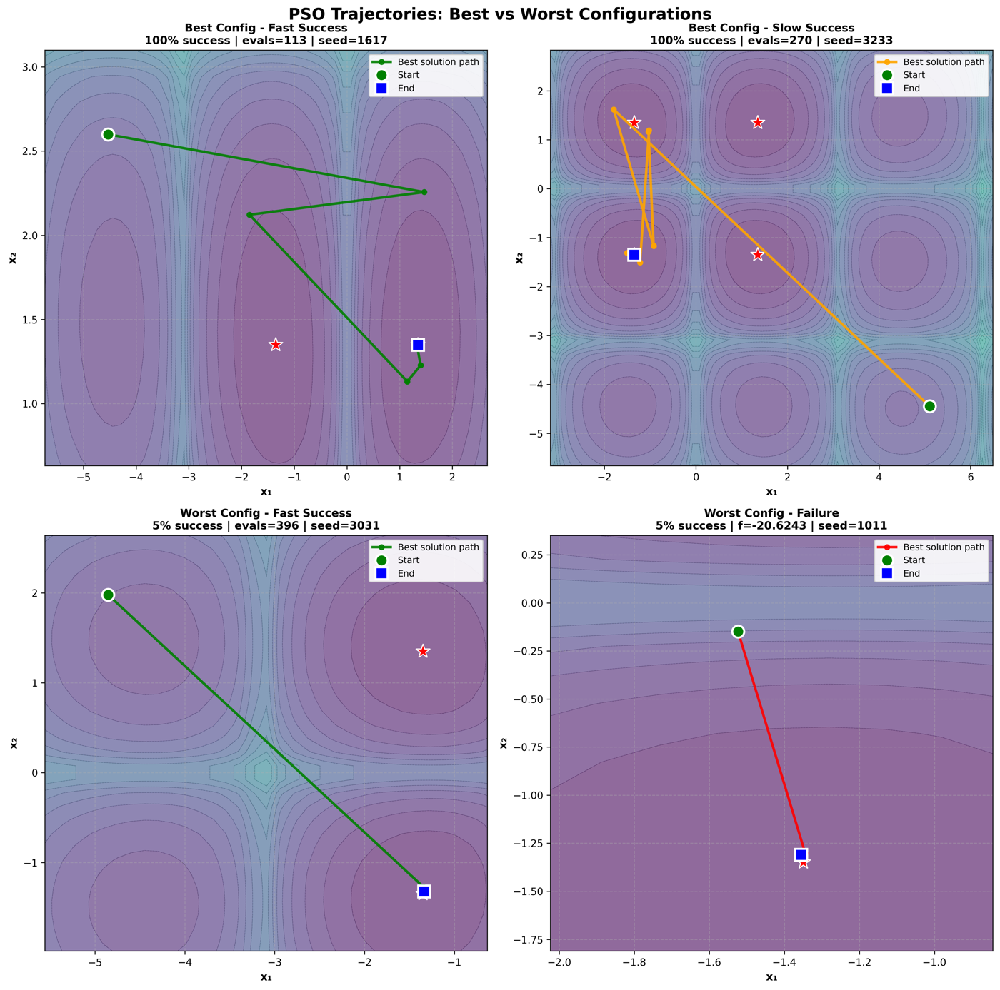
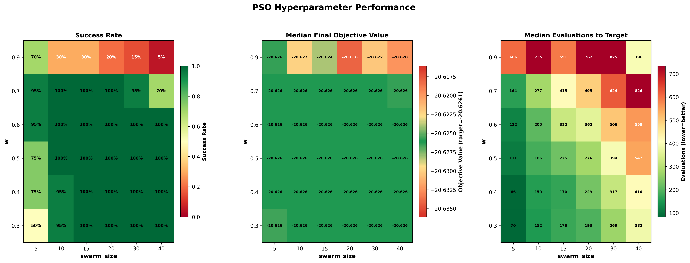
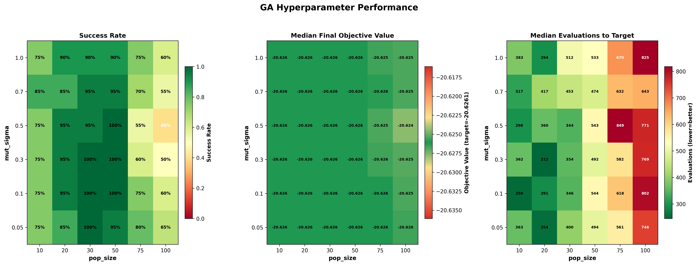
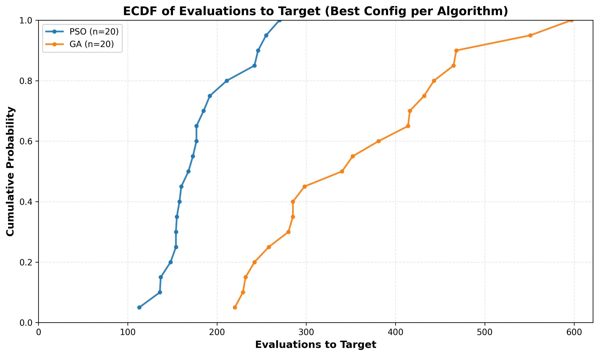

# PSO vs. Genetic Algorithms on a Deceptive Multimodal Landscape

A controlled experimental study of how **Particle Swarm Optimisation (PSO)** and a **real-valued Genetic Algorithm (GA)** behave on the highly multimodal **Cross-in-Tray** function — measuring reliability, speed of convergence, and sensitivity to hyperparameters across **1,440 seeded runs**.

Both algorithms are implemented from scratch in NumPy, evaluated under an identical budget with paired random seeds, and analysed with success-rate heatmaps, ECDFs of evaluations-to-target, convergence curves, basin coverage, and search-trajectory plots.

<p align="center">
  
  <br><em>Best-solution paths of the best and worst PSO configurations over the Cross-in-Tray landscape (stars mark global minima). Even the failing run (bottom right) finds the right basin; it stalls at f = −20.6243, just outside the 10⁻³ success tolerance.</em>
</p>

## Key results

| | **PSO** | **GA** |
|---|---|---|
| Configurations with 100% success | **21 / 36** | 6 / 36 |
| Overall success rate (all configs) | 83.8% | 80.8% |
| Best configuration | swarm = 15, *w* = 0.4 | pop = 30, σ = 0.1 |
| Median evaluations to target (best config) | **≈ 170** | ≈ 346 |

- **PSO is roughly 2× faster** to reach the global minimum at its best settings, and is robust across a wide band of inertia weights (*w* ∈ [0.3, 0.6]) for swarms of 10–40 particles.
- **High inertia breaks PSO.** At *w* = 0.9 the swarm fails to contract and success collapses to 5–70%, worsening with swarm size.
- **GA is limited by generations, not diversity.** Under a fixed 1,000-evaluation budget, large populations (75–100) get only 10–13 generations and success drops to 40–80%; moderate populations (30–50) are the sweet spot.
- Both methods distribute their final solutions across **all four symmetric global minima**, showing no systematic basin bias.

<p align="center">
  
</p>
<p align="center">
  
</p>

<p align="center">
  
</p>

---

## Problem

The Cross-in-Tray function (scaled by 10× relative to the standard form) on $[-15, 15]^2$:

$$
f(\mathbf{x}) = -0.001\left(\left|\sin x_1 \sin x_2 \exp\!\left(\left|100 - \frac{\sqrt{x_1^2 + x_2^2}}{\pi}\right|\right)\right| + 1\right)^{0.1}
$$

It has four symmetric global minima at $(\pm 1.3494, \pm 1.3494)$ with $f^\* \approx -20.6261$, surrounded by a dense lattice of local minima — a demanding test of the exploration/exploitation balance.

## Methodology

| Setting | Value |
|---|---|
| Evaluation budget | 1,000 objective evaluations per run |
| Success criterion | best value ≤ $f^\* + 10^{-3}$ |
| Seeds | 20 fixed seeds ([`experiments/seeds.json`](experiments/seeds.json)), **paired** across every configuration |
| PSO grid (6×6) | swarm size ∈ {5, 10, 15, 20, 30, 40} × inertia *w* ∈ {0.3, …, 0.9}; *c*₁ = *c*₂ = 1.5 |
| GA grid (6×6) | population ∈ {10, 20, 30, 50, 75, 100} × mutation σ ∈ {0.05, …, 1.0}; p_mut = 0.2, p_cx = 0.9, elitism = 1 |
| Total runs | 72 configurations × 20 seeds = **1,440** |

**Algorithms**
- **PSO** — global-best (gbest) variant with inertia weight, cognitive and social terms, and bound clipping ([`src/pso.py`](src/pso.py)).
- **GA** — real-valued encoding with tournament selection, blend crossover, Gaussian mutation and elitism ([`src/ga.py`](src/ga.py)).

Every run logs best-so-far value per evaluation, best position and full population per iteration, evaluations-to-target, and the basin of attraction of the final solution ([`src/logging_utils.py`](src/logging_utils.py)).

## Reproducing

```bash
git clone https://github.com/ebinezer-rajaram/stochastic-optimisation-performance.git
cd stochastic-optimisation-performance
pip install -r requirements.txt

# 1. Run the full grid search (writes results/raw/**.json and results/summary.csv)
python -m experiments.run_experiments

# 2. Generate all figures into results/figures/
python analysis/make_figures.py

# Sanity-check the objective function
python src/objective.py
```

## Repository structure

```
├── src/
│   ├── objective.py        # Cross-in-Tray function + self-tests
│   ├── pso.py              # Particle Swarm Optimisation (gbest)
│   ├── ga.py               # Real-valued Genetic Algorithm
│   ├── logging_utils.py    # RunLog dataclass and JSON serialisation
│   └── utils.py            # Seeding, bound clipping, basin assignment
├── experiments/
│   ├── run_experiments.py  # Grid-search runner (PSO + GA, paired seeds)
│   └── seeds.json          # 20 fixed seeds for reproducibility
├── analysis/
│   └── make_figures.py     # Heatmaps, ECDFs, convergence, basins, trajectories
├── docs/figures/           # Selected figures shown in this README
└── results/                # Generated outputs (gitignored)
```

## Figures produced

`analysis/make_figures.py` generates:

- **Hyperparameter heatmaps** — success rate, median final value and median evaluations-to-target over each 6×6 grid
- **Convergence curves** — median best-so-far with interquartile bands, and best vs. worst configurations
- **ECDF of evaluations-to-target** — full run-time distribution for the best configuration of each algorithm
- **Basin coverage** — which of the four global minima each run converges to
- **Search trajectories** — best-solution paths over the function landscape for fast, slow and failed runs

## Acknowledgements

Originally developed for 4M17 Practical Optimisation, Department of Engineering, University of Cambridge.

## Licence

[MIT](LICENSE) © Ebinezer Rajaram
